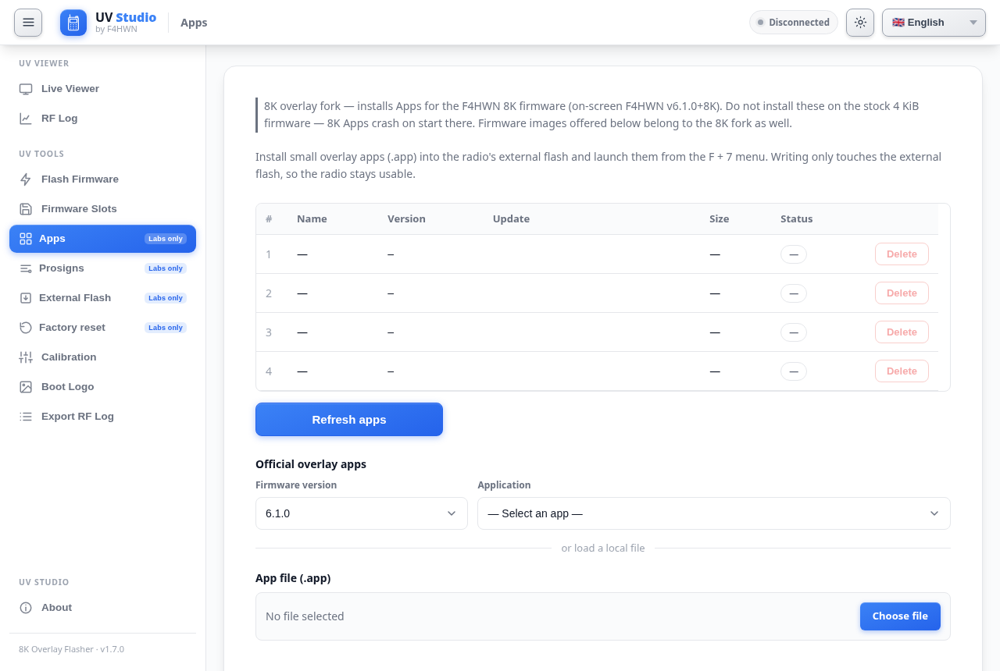
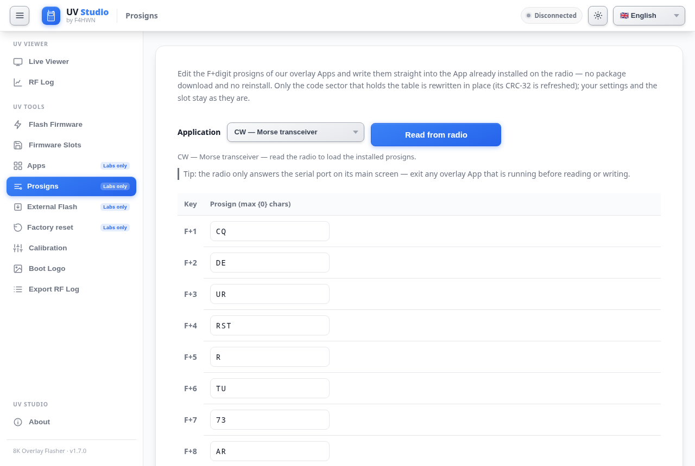

# UV Studio — 8K overlay flasher

> A fork of [armel/uvstudio](https://armel.github.io/uvstudio/) (UV Studio by Armel FAUVEAU,
> Apache-2.0) repointed at **our own 8K overlay firmware and Apps**, so that everything a
> Quansheng UV-K1 / UV-K5 V3 owner needs is reachable from **one page** — no hunting for
> downloads.
>
> **Live page: <https://busybin.github.io/uvstudio-8k-flasher/>**

## What this fork changes

| # | Change | Why |
| --- | --- | --- |
| 1 | Repository slimmed to the UV Studio tool (upstream's homepage/blog content removed) | this fork exists to publish the flasher |
| 2 | App install size gate `0x1000` → **`0x2000`** (8 KiB) + localised "8 KiB" strings | our firmware doubles the overlay App window |
| 3 | App slot stride **`0x2000` → `0x3000`** (4 KiB header + 8 KiB code) | the 8K firmware's slot geometry |
| 4 | Firmware catalog → **`busybin/uv-k1-k5v3-firmware-f4hwn-8k`** (branch `v620-8k`) | the dropdown must offer the 8K firmware, not the stock one |
| 5 | App catalog → same repository (`archive/apps/v6.2.0/`) | the dropdown lists our Apps **and** the official ones |
| 6 | A banner in the Apps tab stating the 8K requirement; our Apps starred in the picker and the catalog | prevents installing 8K Apps on a stock radio |
| 7 | **Prosigns editor** (UV Tools → Prosigns) | edit the prosign table of an installed CW/SECMSG App in place, without reinstalling it |
| 8 | `.nojekyll` + GitHub Pages (branch `master`, root) | the page is served straight from this repository |

Everything else — live viewer, keypad, RF log, firmware slots, calibration backup/restore,
boot logos, firmware flashing, CHIRP driver offer — is upstream's code, untouched.

## Using the page

- **Desktop Chrome, Edge or ChromeOS only** (Web Serial API); the radio must be plugged into
  the machine running the browser. Firefox/Safari and phones are not supported.
- **Apps tab** → *Firmware version* `v6.2.0` → *App catalog*: pick our **CW** or **SECMSG**
  App (the starred entries) or any of the 30 official apps, then install/update straight
  from the catalog. *Installed* and *Catalog* are separate views; apps can be reordered,
  renumbered and removed, and the page shows the 48-slot capacity gauge.
- **Flash tab** → firmware dropdown: **F4HWN Labs (8K fork) v6.2.0** is our 8K build
  (`f4hwn.labs.8k.v6.2.0.bin`). The previous 8K build (`v6.1.0`) stays available for
  rollback.
- **Prosigns** (UV Tools) → reads the prosign table out of the installed App, lets you edit
  the nine slots and writes back only the code sector that changed. The radio only answers
  serial on its **main screen**, so exit a running App first.
- The CHIRP driver offer still resolves from upstream's releases for the matching version —
  that is intentional, the driver belongs to the upstream firmware version.

## ⚠️ Before installing anything

1. **Our Apps need the 8K firmware.** Installing an 8K App on the stock 4 KiB firmware makes
   it crash on start (its `.bss` overruns the stock overlay workspace). The firmware dropdown
   here only offers 8K builds.
2. **Coming from the previous 8K build (v6.1.0+8K)?** Flash the new firmware directly: the
   App slot geometry is unchanged (slot `n` still lives at `0x102000 + n × 0x3000`, the first
   16 slots keep their addresses) and the per-App config layout is byte-identical, so
   installed Apps and their settings survive — no re-install needed. The capacity grows from
   16 to **48 slots**, empty slots disappear from the radio's App menu, and the RX/TX log
   moves to `0x018000` (old log entries are not migrated).
3. Unofficial builds of the official Apps are used on purpose: the `APRS RX` / `APRS TX`
   packages in the catalog carry a stack fix (upstream's freeze on entry under the 8K
   firmware's smaller stack).

## Companion repositories

| Repository | Contents |
| --- | --- |
| [`busybin/uv-k1-k5v3-firmware-f4hwn-8k`](https://github.com/busybin/uv-k1-k5v3-firmware-f4hwn-8k) | the 8K overlay firmware (fork of `armel/uv-k1-k5v3-firmware-custom`, currently v6.2.0) |
| [`busybin/F4HWN-CW-Morse-App`](https://github.com/busybin/F4HWN-CW-Morse-App) | CW (Morse) transceiver overlay App |
| [`busybin/F4HWN-Encrypted-Messenger-App`](https://github.com/busybin/F4HWN-Encrypted-Messenger-App) | encrypted messenger overlay App |

## Licence & attribution

Apache-2.0 (see [LICENSE](LICENSE)). UV Studio is © Armel FAUVEAU, derived from K5Viewer and
UVTools2 (see [NOTICE](NOTICE)); this fork publishes only the modifications listed above,
which are © busybin under the same licence. Forking and keeping forks open follows the
upstream authors' request in the firmware repository.

## Keeping the page current

The firmware and App dropdowns read this fork's own repository
(`busybin/uv-k1-k5v3-firmware-f4hwn-8k`, branch `v620-8k`, `archive/`), so publishing a new
build is: drop the new files into that repository's `archive/` and this page offers them —
no page edit needed. The catalogs follow the firmware version, so an `archive/apps/v6.2.0/`
directory is what a v6.2.0 radio sees.

When upstream UV Studio is synced into this fork again, re-apply the changes in the table
above (each of them is a small, self-contained patch: `js/flash-catalog.js` +
`js/app-catalog.js` repository/branch, `js/flash.js` gate + stride + prosign entry points,
`js/prosign-editor.js` + `css/prosign-editor.css` + their panel in `index.html`, the fork
keys in `locales/*.js`, the About page and the Apps-tab banner).
