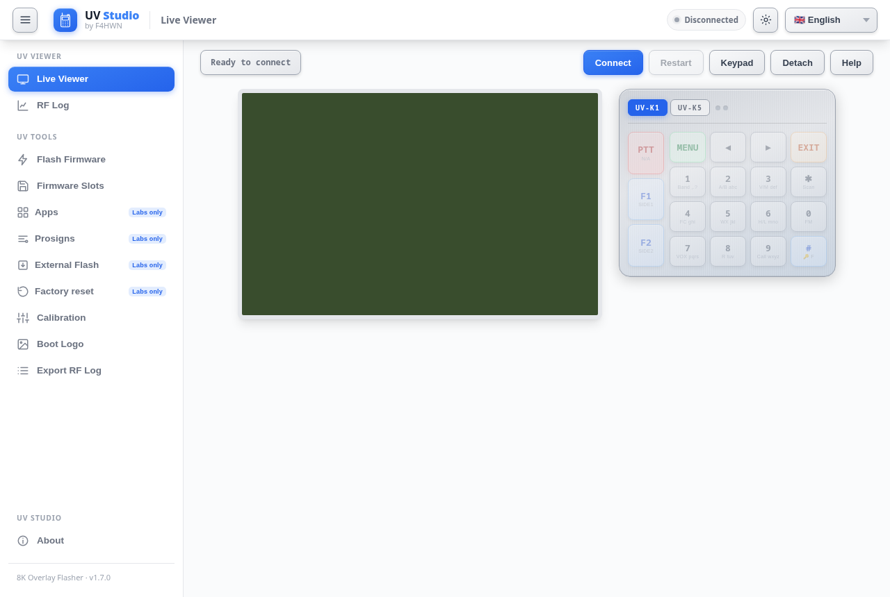

# UV Studio — 8K overlay flasher

One browser page to flash the **F4HWN 8K overlay firmware** and install its overlay Apps on a
Quansheng UV-K1 / UV-K5 V3. No installation, server or account — Web Serial only.

### 👉 https://busybin.github.io/uvstudio-8k-flasher/

## What you do here — two steps

Desktop Chrome / Edge / Opera (or Firefox 151+), radio on a USB cable, same computer.

1. **Flash the system** — either way works, same page:
   - **A. DFU — replaces the firmware.** *Flash Firmware* → **F4HWN Labs (8K fork) → v6.3.0 · 115 KB** →
     radio in **DFU mode** → *Flash firmware*. Back up calibration and channels first
     (*Calibration* → dump, CHIRP for channels).
   - **B. Multiboot slot — keeps the current firmware.** *Firmware Slots* → same build → *Target slot* →
     *Write to slot* (external flash only, the radio stays usable). Then power off, hold **MENU**,
     power on, pick the slot and restore it. Needs a multiboot-enabled firmware already running
     (F4HWN **v6+**); one slot holds at most 118 KiB and you get four user slots plus the automatic
     **Main** backup.
2. **Flash the Apps** — *Apps* → *Application* → *Target slot* → *Install app*. Our **CW** and
   **SECMSG** are starred **★**; the 40 official Apps are in the same list. The radio must be in
   **normal mode**, with no overlay App running.

That's the whole flow: **1) system, 2) Apps**. Both catalogs are read live from
[busybin/uv-k1-k5v3-firmware-f4hwn-8k](https://github.com/busybin/uv-k1-k5v3-firmware-f4hwn-8k),
so new 8K firmware and App builds appear here without a page update.

If you came from stock 4 KiB firmware, the slot layout changes: **install every App again**
after step 1.

> **Multiboot detail:** restoring a slot also selects its configuration bank — slot *N* uses
> **`CFG N`**, while your usual settings sit in **`CFG M`**. The status bar shows which bank is
> active; switch back with the radio's **SetCfg** menu. Never power the radio off while a slot is
> being restored.

## What this fork changes over upstream UV Studio

| | |
| --- | --- |
| Firmware catalog | our 8K fork's `archive/*.bin` — 8K builds only, no upstream 4K images |
| App catalog | our `archive/apps/v<fw>/` — 40 official Apps + CW / SECMSG, matched by App name across version bumps |
| App slot gate | `0x1000` → **`0x2000`** (8 KiB overlay window); 8K Apps are refused on 4 KiB firmware |
| 8K banner | warns on the Apps tab that 8K Apps crash on the stock 4 KiB firmware |
| Prosigns tab | edits the `F`+digit prosign table **inside the installed App** (in-place code sector rewrite, no reinstall) |
| About page | this fork and its repositories |

Everything else — Live Viewer, RF Log, calibration, boot logo, external flash, factory reset,
multiboot slots, ten UI languages — is upstream UV Studio.

## Requirements and safety

- Desktop Chrome, Edge, Opera or ChromeOS; Firefox 151+ also works. Web Serial is not available
  in mobile browsers.
- Flashing takes a minute: keep the cable connected until it finishes.
- An 8K App installed on stock 4 KiB firmware crashes on start — flash the 8K firmware first.

## Run locally

Static HTML/CSS/JS, no build step: `python3 -m http.server 8125` in this directory, then open
<http://localhost:8125/> (Web Serial works on localhost). Tests: `node --test tests/*.test.js`.

## Attribution and licence

Fork of [UV Studio](https://github.com/armel/armel.github.io/tree/main/uvstudio) by Armel FAVREAU
(Apache-2.0), which incorporates K5Viewer and UVTools2; their original notices are kept in
[NOTICE](NOTICE). Licensed under the Apache License 2.0 — see [LICENSE](LICENSE).
